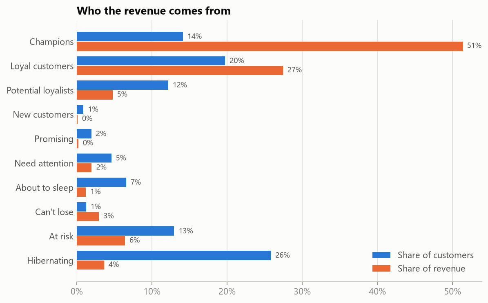
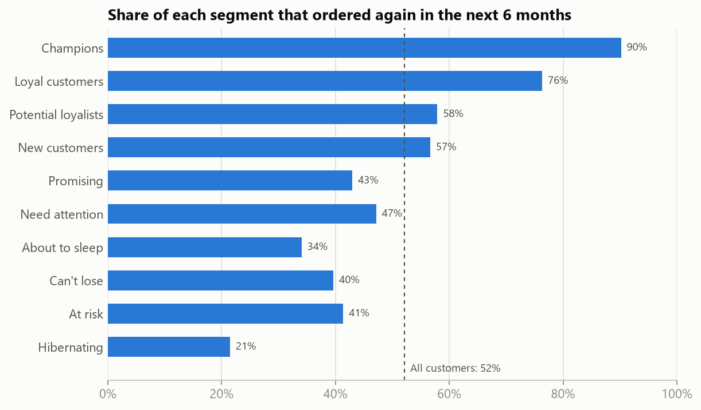
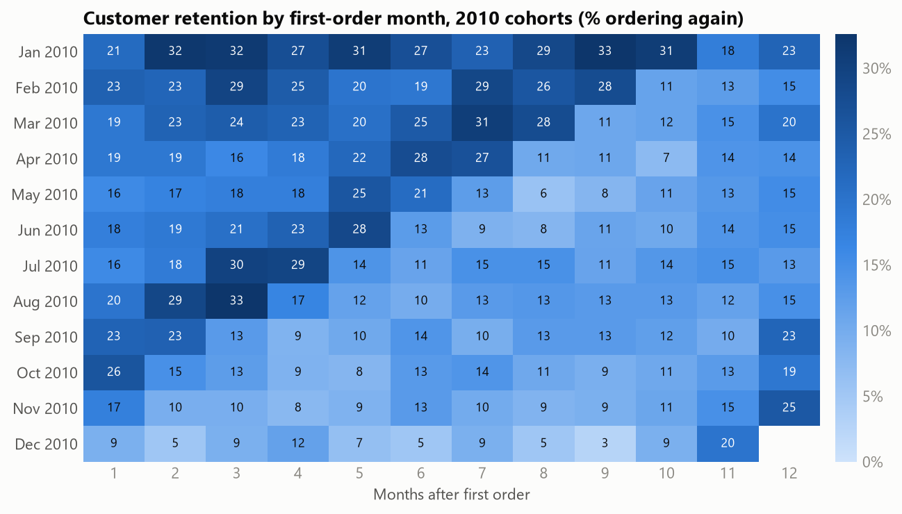
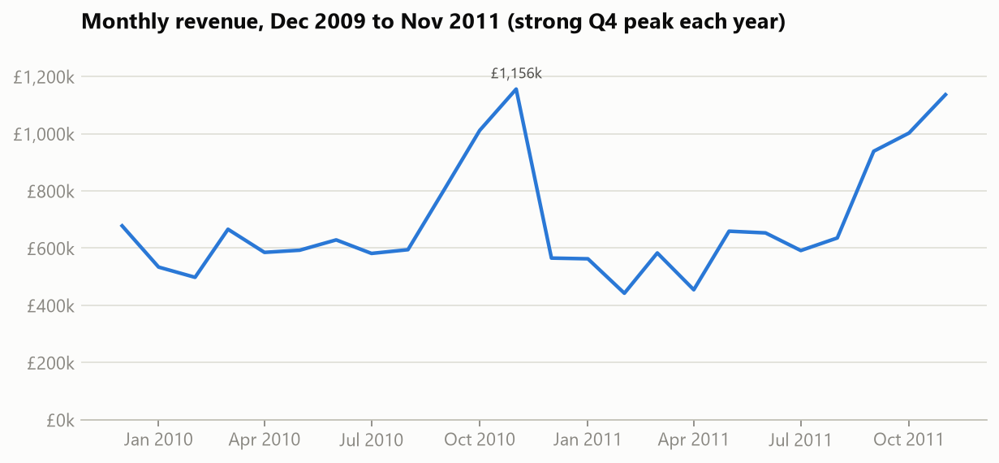

# UK Online Retail: Customer Segmentation

**Which customers drive the revenue of a UK online retailer, which are slipping away, and what should marketing do about each group?**

This project cleans two years of real transactions (about 1.07 million rows, Dec 2009 to Dec 2011) from a UK-based online retailer of giftware, scores all 5,852 customers on **Recency, Frequency and Monetary value (RFM)**, and groups them into ten segments with a recommended action for each. It then checks that the segments actually predict future buying, using a six-month holdout period the segments never saw.

**▶ Interactive dashboard:** *Tableau Public link coming soon*

## Results

| | Share of customers | Share of revenue |
|---|---:|---:|
| **Champions** (bought recently, often, and spent most) | 14% | **51%** |
| **Loyal customers** | 20% | **27%** |
| Hibernating (one or two orders, long ago) | 26% | 4% |

- **A third of customers bring in four-fifths of the revenue.** Champions and Loyal customers are 34% of the customer base but 79% of sales.
- **The segments predict what happens next.** Built only on data up to 9 June 2011, then checked against the next six months:
  - **90%** of Champions ordered again, against **21%** of Hibernating customers and 52% overall.
  - Champions spent **30 times** as much per head as Hibernating customers (£3,685 against £121).
  - Champions and Loyal customers, 34% of customers at the time, brought in **80%** of the next six months' revenue.
- **The "Can't lose" group is small but urgent:** 72 customers who used to order often (16 orders on average) but have not bought for almost a year. They still account for 3% of all revenue, so personal contact is worth the effort.







Customers first won in early 2010 kept ordering: typically 20% to 30% of each cohort placed an order in any given month of their first year. Customers first won in autumn 2010, in the run-up to Christmas, mostly fell to around 10% after their first month or two. Seasonal shoppers need a different follow-up from regular buyers.



## Segments and recommended actions

| Segment | Who they are | Action |
|---|---|---|
| Champions | Bought recently, often, high spend | Reward; early access to new ranges; ask for reviews |
| Loyal customers | Order regularly | Upsell higher-value ranges; loyalty scheme |
| Potential loyalists | Recent, a few orders | Membership offer; recommend related products |
| New customers | First order very recently | Onboarding emails; make the second order easy |
| Promising | Recent, one order | Build awareness of the wider range; small incentive |
| Need attention | Middling on recency and frequency | Time-limited, personalised offer |
| About to sleep | Fading, few orders | Reactivation email with popular products |
| Can't lose | Used to order very often, gone quiet | Personal contact; win back before they leave |
| At risk | Ordered a few times, long ago | Win-back campaign; find out what changed |
| Hibernating | One or two orders, long ago | Low-cost reminder only; do not over-spend |

## How it works

1. **Cleaning** ([`retail/clean.py`](retail/clean.py)), with every step logged in [`cleaning_log.csv`](outputs/tables/cleaning_log.csv):

   | Step | Rows removed |
   |---|---:|
   | Exact duplicate rows | 34,335 |
   | No customer ID (cannot be linked to a customer) | 235,151 |
   | Cancelled orders (invoice starts with "C") | 18,390 |
   | Postage, fees, manual adjustments and test codes | 2,858 |
   | Zero or negative quantity or price | 60 |
   | **Clean rows kept** | **776,577** |

2. **RFM scores** ([`retail/rfm.py`](retail/rfm.py)). For each customer: days since last order (recency), number of orders (frequency) and total spend (monetary). Each is split into five equal-sized bands scored 1 to 5. Customers are ranked first so that ties, such as the 28% of customers with exactly one order, still split evenly.
3. **Segments.** The recency and frequency scores together map to one of ten standard RFM segments ([`retail/config.py`](retail/config.py)). Every one of the 25 combinations maps to exactly one segment, and a test checks this.
4. **Holdout check.** The segments are rebuilt using only purchases up to 9 June 2011. The script then measures what each segment actually bought from 9 June to 9 December 2011.
5. **Cohorts.** Customers are grouped by the month of their first order, and the share still ordering 1, 2, 3 and more months later is tracked.

## Tableau data sources

The dashboard is built from the CSVs in [`outputs/tableau/`](outputs/tableau):

| File | One row per | Use it for |
|---|---|---|
| `customers.csv` | customer (5,852) | segment, country, R/F/M scores, spend, first and last order |
| `segment_summary.csv` | segment (10) | headline KPIs per segment and the recommended action |
| `monthly_sales.csv` | month x market (UK / International) | revenue, orders, active and new customers over time |
| `cohort_retention.csv` | first-order month x months since | the retention heatmap |

`complete_month` is `False` for December 2011, which holds only 9 days of data. Filter it out so it doesn't look like a collapse.

## Assumptions and limitations

- **Rows without a customer ID (23% of rows after removing duplicates) are excluded,** because they cannot be tracked over time. Revenue figures here are for identified customers only.
- **Cancellations are removed, not netted off** against the original order, so monetary value is gross spend.
- According to the dataset description, **many customers are wholesalers**, so order values (£466 on average) are higher than in typical consumer retail.
- 91% of customers and 84% of revenue are in the UK. International customers are included and can be filtered in the dashboard.
- RFM looks backwards. It ranks customers by past behaviour; the holdout check shows that this predicts the next six months well, but it is not a forecast of individual customer value.

## Run it yourself

```bash
python -m venv .venv
.venv\Scripts\activate            # Windows  (macOS/Linux: source .venv/bin/activate)
pip install -r requirements.txt
python run_analysis.py            # about 3 minutes the first time (reads the Excel file), seconds after
pytest                            # 6 tests: cleaning rules, RFM values, equal bands, segment map, cohorts
```

Download the data first: [Online Retail II](https://archive.ics.uci.edu/dataset/502/online+retail+ii) from the UCI Machine Learning Repository. Unzip `online_retail_II.xlsx` into `data/raw/`.

```
retail/       config.py (settings and segment map) · clean.py · rfm.py · figures.py
run_analysis.py
outputs/      tableau/ (dashboard data) · tables/ (cleaning log, holdout check) · figures/
tests/
```

## Why I built this

My earlier work was on the operations side (raw-material forecasting at a feed mill) and in airline commercial analytics. This project applies the same approach to customers: start from the business question, clean the data carefully, test whether the method works on data it hasn't seen, and end with a recommended action for each group.

---
Data: Chen, D. (2012). *Online Retail II* [Dataset]. UCI Machine Learning Repository. https://doi.org/10.24432/C5CG6D (CC BY 4.0). Built by [Obaid Ullah Masood Raja](https://www.linkedin.com/in/obaidullah-masood-raja-225795218).
